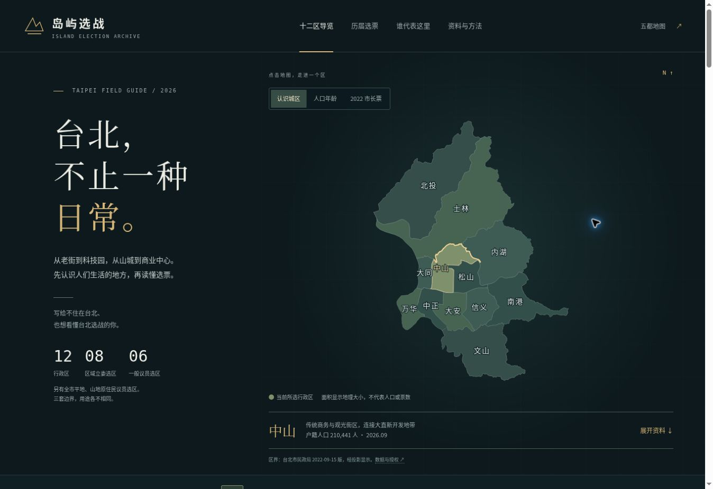

# 台北十二区：维护、来源与编辑说明

资料核对日：**2026-10-20**。本页记录当前专题的数据口径与维护方式；核对日不等于各项资料的统计日期。

## 页面范围与入口

[专题入口](https://randomclb.github.io/island-election-atlas/taipei.html)为 `taipei.html`。本地运行 `npm start`，打开 `http://127.0.0.1:4173/taipei.html`；`?district=zhongshan` 等参数可直接定位行政区。

当前覆盖 12 个行政区的地方画像、户籍人口与年龄、税务所得、登记产业、每区 3 条共 36 条议题观察问题、六组历史选举数据、区域立委、2026 市议员选区与参选名单，以及两区对照。它帮助外地读者理解地域差异、选举制度和可追问的政策问题。

**尚未完成每位市议员参选人的逐条政见与个人表现比较。** 名单、人数、席次与历史成绩不能代替这项工作；也不能据此声称已完整覆盖本届候选人、预测胜率或给候选人评分。市长人物与政见另见主站台北档案。

## 基础资料：年份、单位与限制

| 数据 | 当前口径 | 官方来源与使用限制 |
| --- | --- | --- |
| 人口、户数 | 2026 年 9 月；同比为 2025 年 9 月 | [台北市户籍人口数据](https://data.taipei/dataset/detail?id=6a1dbb4e-e99c-4e67-ab09-f6d83852dc99)。户籍人口不等于实际常住人口、日间活动人口或本届选举人数。 |
| 年龄结构 | 同为 2026 年 9 月；逐岁加总 0—14 岁及 65 岁以上 | [台北市年龄数据](https://data.taipei/dataset/detail?id=64c8a3a0-3b9a-4f49-a13a-fb1eb2ffa4b1)。比例以同区同月户籍人口为分母，不能把不同月份混算。 |
| 税务所得 | 2023（民国 112）所得年度；新台币／纳税单位／年 | [财政部综合所得税统计](https://data.gov.tw/dataset/17983)、[112 年原始 CSV](https://www.fia.gov.tw/WEB/fia/ias/ias112/112_165-A.csv)。展示每区“合计”行的综合所得总额中位数，不能对各里中位数求平均。 |
| 公司与商号 | **2026-09-23 更新版本** | [公司登记](https://data.taipei/dataset/detail?id=544c7e21-e18a-4904-9f32-15fae2e30acc)、[商号登记](https://data.taipei/dataset/detail?id=d32fe131-6965-47e3-9433-7352a2ff2681)。原 CSV 没有统计月字段，不能标作“2026 年 9 月底”。行业占比以本区登记公司总数为分母。 |
| 行政区地图 | 区界版本 **2022-09-15**；2026-10-20 取得 | [台北市区界图](https://data.gov.tw/dataset/121199)，发布机关为台北市政府民政局，采用政府资料开放授权条款第 1 版。取得日或平台更新日不能当作区界版本日。 |

税务所得**不是个人薪资，也不是家庭可支配所得**；该口径不含政府移转支出、免税与分离课税所得，不能直接当作贫困率、资产财富或贫富差距指标。页面将金额换成“万元”仅为显示，快照保留新台币原值。

公司、商号的登记地址、登记类别与家数，不能直接说明居民的职业结构、实际就业地点、就业人数或地区产值。产业叙述还需结合有出处的空间与建设资料，不从登记数量推出经济效益或政治偏好。

地图快照保留原始区界几何，由 TWD97 TM2 121（EPSG:3826）转换为 WGS84 经纬度，再投影为 SVG；未简化几何。来源地址、授权、区界日期及原始压缩包 SHA-256 记录在 `boundaries.geojson`，生成后的显示坐标保留至 0.01 px。地理面积不表示人口或选票规模，此图也不等同于立委选区图。

## 历史选举：保留完整分母

六组数据来自[中选会选举资料库](https://db.cec.gov.tw/)：2014、2018、2022 市长，2024 总统、区域立委及政党票。各届官方网页与原始 JSON 地址逐项保存在 [elections.json](../research/taipei-districts/elections.json)。这是所选届次的完整票数记录，不是从早期至今连续无缺的全部历史。

- 市长、总统与政党票按 12 行政区展示；区域立委成绩按 8 个立委选区展示。应先对齐票种与地理层级，再作比较。
- 得票率分母是该票种、该地区的**全部有效票**。界面先显示前三名，其余候选人或政党仍完整保留并可展开；不按前三名重新归一化。
- 投票率为投票数除以该票种选举人数。不同票种的资格与官方选举人数可能不同，不能共用一个分母，也不能用 2026 户籍人口代替。
- 全市合计先加总票数、有效票与选举人数，再重算比例；不能直接平均各区得票率或投票率。2024 总统原始资料的正副总统票数重复列示，快照只保留每组一列并附搭档，避免加倍。
- **2014、2018 市长官方得票率采用小数二位截尾；2022、2024 文件采用小数二位四舍五入。** 快照 `share` 保留官方公布值，`marginPoints` 从完整票数与有效票分母计算。官方百分比总和略低于 100%，或自行四舍五入与官方截尾差 0.01 个百分点，不代表票数错误。全市重算值也可能与官方截尾值略有差异；以原始票数核对。
- `districtLeader` 是该行政区最高票，`officialElected` 是整场选举当选者。市长在全市选出，不能把每区最高票写成“该区当选市长”。

[选举核对记录](../research/taipei-districts/election-audit.json)记录完整候选人、分母、全市总数及相关选区与代表核验。历史得票显示一次选举的结果，不能充当本届民调，也不能据区级人口或收入推断个人投票行为。

## 三套地域与代表关系

台北有 12 个行政区、8 个区域立委选区、6 个一般市议员选区，另有全市平地原住民及山地原住民议员选区。不能把“行政区”“立委选区”“议员选区”混用。

| 第 11 届区域立委选区 | 行政区关系 |
| --- | --- |
| 第 1 选区 | 北投全区＋士林 13 里 |
| 第 2 选区 | 大同全区＋士林 38 里 |
| 第 3 选区 | 中山全区＋松山 20 里 |
| 第 4 选区 | 内湖、南港全区 |
| 第 5 选区 | 万华全区＋中正 21 里 |
| 第 6 选区 | 大安全区 |
| 第 7 选区 | 信义全区＋松山 13 里 |
| 第 8 选区 | 文山全区＋中正 10 里 |

完整里名和[中选会选区范围原始 CSV](https://data.cec.gov.tw/第11屆立法委員選舉區範圍/立法委員選舉區範圍.csv)链接保存在 `elections.json` 的 `legislativeBoundaries`。士林、松山、中正须查里名，不能把整个行政区指给一位立委，也不能把整个立委选区的成绩当成该行政区成绩。

现任立委按立法院现任资料核对至 2026-10-20；`legislators` 保留每位委员的来源与状态核对日。后续变动须重新查核，不能只因其 2024 当选就持续标为现任。2026-11-28 的地方选举在台北改选市长、市议员、里长，**不改选立委**；区长也不是这次选举的职位。

## 2026 名单与选务阶段

当前 [council-2026.json](../research/taipei-districts/council-2026.json)结合[市议员登记册](https://web.cec.gov.tw/mect/article/64448)、[市长登记册](https://web.cec.gov.tw/mect/article/64441)、[2026-10-16 资格审查公告](https://web.cec.gov.tw/central/article/65213)、[席次公告](https://www.cec.gov.tw/central/article/63626)与[选务日程](https://web.cec.gov.tw/central/article/61722)。网页、PDF、公布日与资料阶段均保留在快照内。

- 截至 2026-10-20，议员原登记 98 人，扣除公告的 1 名不符资格者后为 97 人，含一般与原住民选区。被排除者仍保留原登记记录及原因；最终状态须随正式名单与后续裁决更新。
- 议员应选共 61 席：一般选区 59 席，平地、山地原住民各 1 席。妇女保障名额包含在总席次内，不额外相加，也不是女性当选人数上限。名单人数与席次不能直接表示谁有优势。
- 号次抽签定于 **2026-10-23**，截至核对日尚未举行。当前顺序是登记顺序，不能解释为号次、支持率或当选机会。
- 投票定于 **2026-11-28，08:00—16:00（台北时间）**。资格审查后的整理记录仍须与正式候选人名册及后续公告核对。

未来补号次、资格变动、退选、递补或当选状态，必须取得相应官方公告或具名官方记录，保留日期、链接与变更依据；不能按原登记次序、媒体猜测或时间已经过去而自动推断状态。

## 地方画像与 36 条议题的编辑原则

每区的 `profile`、`industry` 与三条 `issues` 由公开地理、商业、人口及建设资料整理。每条议题保存背景、观察问题、权责提示和 `sourceIds`；来源表保留发布机关、资料日期及必要的立场说明。

**36 条议题是编辑提出的问题，不是民意调查或选民关注度排名。** 所引市府规划与开发资料反映官方计划、程序或官方视角，不能代替居民、商户、承租人或开发商意见。描述争议时，应将事实、机构立场和编辑推问分开；新增当事人或其他来源时也应明确归属。

维护时保留各区内部差异，不给整区居民贴政治、阶层或职业标签，不从老龄化、所得或产业直接推出投票因果。交通与开发项目须区分规划、核定、施工、营运，预期就业与经济效益不得写成已经实现；问题中的责任归属要区分市府执行、议会监督及中央权限。

## 文件与更新流程

| 文件 | 应编辑的内容 |
| --- | --- |
| [profiles.json](../research/taipei-districts/profiles.json) | 12 区画像、人口与年龄、所得、登记产业、36 条议题、来源字典和口径说明 |
| [elections.json](../research/taipei-districts/elections.json) | 六组历史票数、立委选区里名、现任立委、议员选区与选举日期 |
| [council-2026.json](../research/taipei-districts/council-2026.json) | 2026 登记与资格阶段、名单、席次、选务日程及公告来源 |
| [boundaries.geojson](../research/taipei-districts/boundaries.geojson) | 官方区界几何、坐标转换说明、来源版本、授权与原始文件校验值 |
| [election-audit.json](../research/taipei-districts/election-audit.json) | 已执行的选举资料核对记录；新增核对须据实更新，不能只改成“通过” |

1. 先读取新的官方原件，确认统计期、地理单位、分母和状态。将来源链接、发布日期、资料日期与核对日分别记录；来源缺项时明确留空或说明，不能猜测。
2. 编辑上述研究快照。保留稳定的区 ID 与官方名称；每个 `sourceIds` 必须能在来源字典解析。更换人口期别时，一并更新年龄分母、同比基期与全市合计；更换所得年度时保留原口径。
3. 在仓库根目录运行以下命令，重新生成显示数据与静态产物：

   ```sh
   npm run build
   npm test
   npm start
   ```

   `scripts/build.cjs` 会调用 `scripts/build-taipei-guide.cjs`，由快照生成 `public/taipei-guide-data.js` 和 `public/taipei-guide-map.js`，再输出 `dist/` 并为静态资源生成内容指纹。**不要手改这两个生成文件；构建不会联网刷新数据，也不会自动发布。** `npm test` 包含专题的完整分母、区界关系、名单及路由校验。
4. 检查生成差异，并在本地专题页检查 12 区切换、两区对照、历史票数、来源入口、窄屏显示与深链接。数据快照与两个生成文件应保持同步；发现过期文字须一起修正。
5. 核对日或选务阶段变更时，还需检查 `public/taipei.html` 与 `public/taipei-guide.js` 中固定的日期和阶段文案，以及相关测试断言；生成器不会自动替换这些文本。发布继续使用仓库既有的 `ATLAS_PUBLIC_RELEASE=1 npm run build` 与 `gh-pages` 流程。

一般内容规范另见 [EDITORIAL.md](EDITORIAL.md)。后续扩充候选人政见与个人表现时，需要新的逐人证据记录和可比口径；仅补上姓名、党籍或票数不能算完成。

## 本次验证记录（2026-10-20）

- `npm test`：61 个测试文件通过；专题新增的 8 项检查涵盖完整票数、独立全市总数、选区与里名、名单状态、席次及 URL 回退。
- `ATLAS_PUBLIC_RELEASE=1 npm run build`：通过；两个入口引用的全部指纹资源存在，产物不含临时手机检查页面。
- 浏览器：逐一切换 12 区与 5 个行政区票种，核对代表与议题更新；检查图层、地图键盘操作、比较控件、名单展开、浏览器返回及旧站入口。
- 窄屏：在 390 × 844 的测试框架中检查（内容视口宽 375 CSS px），地方资料、选票和两区表格均未产生页面级横向溢出；补齐手机阅读导航。桌面站点控制台未见本应用错误。
- 复制链接在当前 HTTP 预览环境进入提示回退；真实 HTTPS 环境仍依浏览器剪贴板权限决定是否可直接复制。


